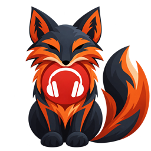

# Identidad visual de FulviFetch



El logo actual es el zorro frontal con auriculares, aportado por el usuario,
con fondo transparente y las dos orejas corregidas.

- Imagen maestra: [zorro-frontal-v2/zorro-maestro.png](zorro-frontal-v2/zorro-maestro.png).
- Icono para la ficha de Mozilla: [PNG de 128 px](zorro-frontal-v2/icons/icon-128.png).
- Tamaños disponibles: 16, 32, 48, 64, 96, 128, 256, 512 y 1024 px.
- Archivo ICO: [zorro-frontal-v2/zorro.ico](zorro-frontal-v2/zorro.ico).

Los iconos de 16 a 128 px se incluyen en `extension/public/icons/` para la
extensión. El README principal utiliza el PNG de 256 px.

Para volver a exportar los tamaños desde la raíz del proyecto:

```powershell
./media/exportar-iconos.ps1 -Source ./media/zorro-frontal-v2/zorro-maestro.png -Destination ./media/zorro-frontal-v2
```

`mejorados/` conserva el diseño anterior; el diseño vigente está en
`zorro-frontal-v2/`.
